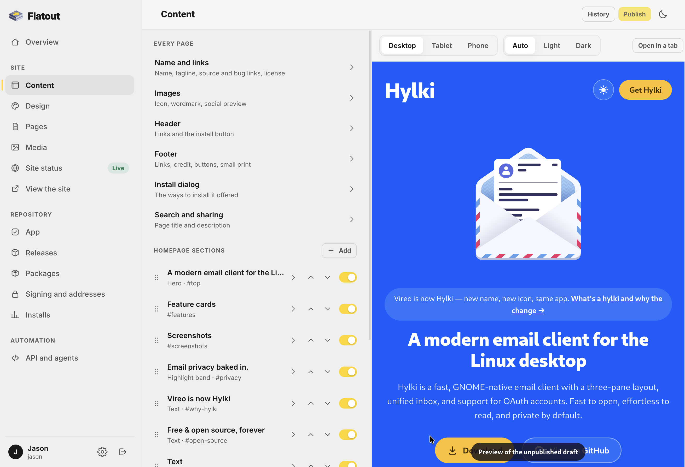
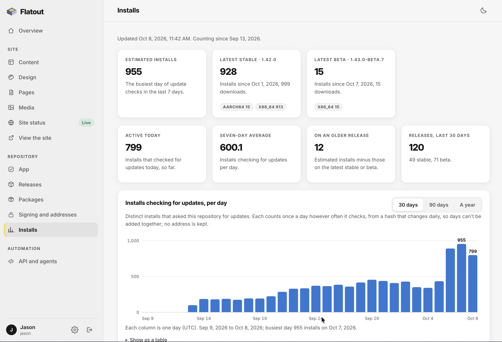

<p align="center">
  
</p>

<h1 align="center">Flatout</h1>

<p align="center"><strong>A self-hosted Flatpak, AppImage, DEB and RPM repo builder</strong></p>

<p align="center">
  <a href="LICENSE"></a>
  
</p>

Flatout publishes a Linux app from one Docker container. It runs signed Flatpak,
dnf and apt repositories for your bundles, RPMs and DEBs. It serves AppImages
that update themselves from your site. It also gives the app a homepage that you
edit in the browser or turn off. Upload a file and the update reaches every
install. Scripts and AI agents can do all of it through an API and an MCP server.

<p align="center">
  
  
</p>

## Features

- **Flatpak.** Flatpak's own tools import each bundle, sign it and publish it
  with static deltas. Installs update through GNOME Software, KDE Discover or
  `flatpak update`. You can bring back an earlier build or end a channel with a
  message to its users.
- **RPM.** An uploaded `.rpm` is signed with the repository's key and added to
  a signed dnf repository. Installs update with `dnf upgrade` or the system's
  software app.
- **DEB.** An uploaded `.deb` goes into a signed apt repository. The `.sources`
  file people add carries the key inside it. Installs update with `apt upgrade`
  or the system's software app.
- **AppImage.** Each upload is told to check your site for updates and gets a
  zsync file. Gear Lever, AppImageLauncher and AppImageUpdate bring each new
  version. The last two fetch only the blocks that changed.
- **Other downloads.** Any other file such as a tarball is offered as a download
  at an address that stays the same.
- **One place to upload.** Drop every file of a version on the Releases page.
  Flatout works out each file's format and puts it where it belongs.
- **Stable and beta channels** in every format. Promote a beta to stable without
  uploading it again or withdraw a version in every format at once.
- **A homepage you edit in the browser.** Change every section's text, which
  sections show and in what order. Set the colors for light and dark, the fonts,
  the type size and the images. A live preview shows the draft and nothing goes
  live until you publish. You can also turn the site off and keep only the
  repositories.
- **Release notes from the repository.** The homepage shows the newest releases
  and a release notes page lists them all, sorted by version and filtered by
  channel.
- **Install files that write themselves.** The `.flatpakref`, `.flatpakrepo`,
  `.repo` and `.sources` files, the download buttons and every command in the
  install dialog follow the current release, key and address.
- **Install numbers without telemetry.** They come from ordinary repository
  traffic and the app reports nothing.
- **An API and an MCP server** with scoped tokens for CI and AI agents.
- **Encrypted backups** of everything. A fresh install's setup can restore them.
- Accounts, a first-run setup wizard, Cloudflare Turnstile for sign-in and light
  and dark themes.

## Install with Docker Compose

```sh
mkdir flatout && cd flatout
curl -O https://raw.githubusercontent.com/hyprlab/flatout/main/docker-compose.yml
curl -o .env https://raw.githubusercontent.com/hyprlab/flatout/main/.env.example
docker compose up -d
```

The `.env` file holds the settings as one `NAME=value` per line with a comment
explaining each. All of them are optional and Flatout starts with the file as it
comes. A public site behind a reverse proxy with HTTPS also needs `TRUST_PROXY=1`
and `SESSION_COOKIE_SECURE=1`. Set them and run `docker compose up -d` again
([all the settings](docs/DOCUMENTATION.md#the-env-file)).

Then open http://localhost:8102. The first visit opens the setup wizard and the
admin walks you through the rest. A public site needs a reverse proxy with HTTPS
in front of it ([how](docs/DOCUMENTATION.md#behind-a-reverse-proxy)).

## Publishing a release

Upload your files in the admin under Releases or from CI with a token. Flatpak
bundles are built one per architecture and go to `/api/v1/releases`:

```sh
flatpak build-bundle --runtime-repo=https://dl.flathub.org/repo/flathub.flatpakrepo \
  build-repo org.example.App-x86_64.flatpak org.example.App
curl -fsS -H "Authorization: Bearer $FLATOUT_TOKEN" \
  -F file=@org.example.App-x86_64.flatpak -F channel=stable \
  https://app.example.org/api/v1/releases
```

RPMs, DEBs, AppImages and other files go to `/api/v1/packages`
([more on packages](docs/DOCUMENTATION.md#packages)):

```sh
for file in myapp-1.2.0-1.x86_64.rpm myapp_1.2.0_amd64.deb MyApp-1.2.0-x86_64.AppImage; do
  curl -fsS -H "Authorization: Bearer $FLATOUT_TOKEN" \
    -F file=@"$file" -F channel=stable \
    https://app.example.org/api/v1/packages
done
```

Agents connect to the MCP server at `/mcp`:

```sh
claude mcp add --transport http flatout https://app.example.org/mcp \
  --header "Authorization: Bearer YOUR_TOKEN"
```

## Documentation

| | |
| --- | --- |
| [Documentation](docs/DOCUMENTATION.md) | Setup, the site, releases, packages, the API and MCP, configuration and backups |
| [Architecture](docs/ARCHITECTURE.md) | How the pieces fit and why |
| [Design system](docs/DESIGN.md) | The admin's components and the public site's theme tokens |
| [Contributing](docs/CONTRIBUTING.md) | Commits, prose style, tests |
| [Releasing](docs/RELEASING.md) | Versions, the beta and stable channels |
| [Security](docs/SECURITY.md) | What it defends against and how to report a problem |
| [Changelog](CHANGELOG.md) | What changed in each release |

## AI notice

Flatout is built by a human maintainer who uses generative AI as a development
tool. The maintainer decides what gets built, reviews the results, tests every
release and signs off on everything that ships. Commits are made under the
maintainer's name. The tool is declared here once for the whole repository
instead of in a trailer on every commit. The app itself contains no AI and makes
no requests to AI services. Its MCP server is there for agents you choose to
connect.

## License

Flatout is free software licensed under the **GNU Affero General Public License
v3.0 or later** ([AGPL-3.0-or-later](LICENSE)). Cantarell and Inter are under
the SIL Open Font License ([credits](docs/CREDITS.md)).

© 2026 Hyprlab
